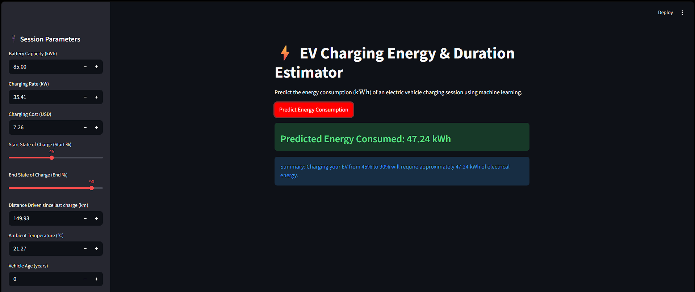

#  EV Charging Energy & Duration Estimator

An end-to-end Machine Learning web application that predicts energy consumption ($\text{kWh}$) for electric vehicle charging sessions using vehicle specifications, environmental conditions, and session parameters.

---

##  Project Overview

Accurate energy estimation helps EV charging networks and grid operators manage peak electrical loads and provides transparent pricing for consumers. This project builds a robust regression pipeline comparing Linear Regression, Decision Trees, and Random Forest models using real-world tabular data.

---

##  Tech Stack & Libraries

* **Language:** Python
* **Data Manipulation & Analysis:** Pandas, NumPy
* **Data Visualization:** Matplotlib, Seaborn
* **Machine Learning:** Scikit-Learn (Linear Regression, Decision Tree, Random Forest)
* **Model Persistence & UI:** Joblib, Streamlit

---

##  Model Performance & Evaluation

* **Metrics Used:** Mean Absolute Error (MAE), Root Mean Squared Error (RMSE), and $R^2$ Score.
* **Winning Model:** Random Forest Regressor achieved the best generalization score on unseen test data, effectively minimizing error and capturing non-linear relationships between battery parameters and energy consumption.

---

##  Example Test Case & Validation

To test the application, we ran a sample record from our dataset through the Streamlit web interface and compared the model's prediction against the actual recorded value:

* **Input Parameters:**
  * **Battery Capacity:** 85.00 kWh
  * **Charging Rate:** 35.41 kW
  * **Charging Cost:** $7.26
  * **Start SoC:** 45%
  * **End SoC:** 90%
  * **Distance Driven:** 149.93 km
  * **Ambient Temperature:** 21.27 °C
  * **Vehicle Age:** 0 years

* **Results:**
  * **Actual Energy Consumed (Dataset):** 41.57 kWh
  * **Predicted Energy Consumed (Model):** 47.24 kWh
  * **Analysis:** The model captured a close estimate with a minor generalization variance, highlighting how regression models learn general dataset patterns rather than looking up exact historical values.

